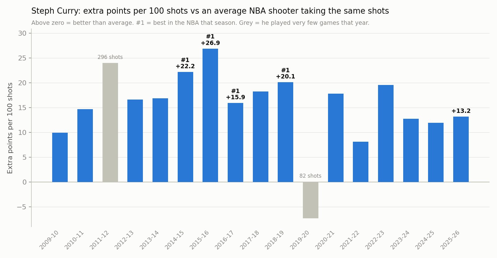
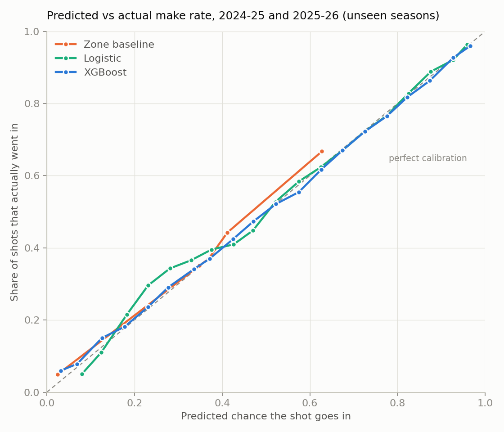

# Shot Quality vs Shot Making: An Expected-Points Model for Stephen Curry

> **Status:** Data pipeline, model, Curry's full-career analysis and both dashboards done. Next: automated in-season refresh.
>
> **▶ Interactive dashboard:** https://mega-anokye.github.io/nba-shot-quality-model/ (filter Curry's 19,152 shots by season, result and zone; explore the league leaderboard)

## The question

> *"Steph Curry is the greatest shooter God ever created."* That's what I've always said. This project puts the claim to the data.

How much of Stephen Curry's scoring comes from **getting good shots** (shot quality), and how much from **making hard ones** (shot making)?

Raw field-goal percentage mixes the two together. A player who only takes layups can shoot 65% and still be an average scorer. This project builds an **expected-points (xPTS) model**: for every shot, it estimates how many points an average NBA player that season would score from the same spot and situation. Then it measures how far Curry (and every other shooter) beats that expectation.

## Headline findings

1. **Curry is the best shot-maker of the last 17 seasons.** Across 19,152 shots since 2009-10 he scored **3,188 points more** than an average shooter would have from the same shots: **+16.6 per 100 shots**, 1st among the 219 players with at least 5,000 attempts. Kevin Durant (+2,917) and Nikola Jokić (+2,218) are next.
2. **His edge is shot making, not shot selection.** His shots are worth 1.00 expected points each, slightly *below* the league average of 1.04, because he takes so many long, hard threes. He turns them into 1.16.
3. **He was the NBA's best shot-maker in four seasons:** 2014-15, 2015-16 (+26.9 per 100, his unanimous MVP year), 2016-17 and 2018-19. He was top 5 in 12 of his 15 full seasons, and still 5th and 12th in his late 30s.
4. **NBA.com's shot labels leak the outcome before 2017-18**, and a model that uses them gets Curry's early career badly wrong. See below.



## Method

| Step | What | Tools | Status |
|---|---|---|---|
| 1. Data | Every NBA regular-season shot, 2009-10 to 2025-26 | Python, `nba_api` | ✅ |
| 2. Storage | Star schema: `fact_shot`, `dim_player`, `dim_team`, `official_team_totals` | SQLite, SQL | ✅ |
| 3. Checks | Reconcile every team-season against official totals; data quality checks | Python, SQL | ✅ |
| 4. Model | Make probability per shot: zone baseline vs logistic regression vs XGBoost | scikit-learn, XGBoost | ✅ |
| 5. Metric | **Points Above Expected (PAE)**, every shot scored out-of-sample | pandas, SciPy | ✅ |
| 6. Dashboards | Interactive web dashboard + Power BI report (shot chart, leaderboard, Curry by season and zone) | Plotly.js, GitHub Pages, Power BI, DAX | ✅ |
| 7. Automation | Nightly data refresh during the season | GitHub Actions | ⏳ |

## The data, and how it was checked

| | |
|---|---|
| League shots | **3,493,111** regular-season attempts, 17 seasons, 1,954 players, 30 teams |
| Curry shots | **19,155** regular-season attempts, 2009-10 to 2025-26 |
| Reconciliation | All **510 team-seasons** tie exactly to the NBA's official FGA, FGM, 3PA and 3PM |
| Duplicates | None (unique key: game ID + event ID) |
| Cross-check | All of Curry's shots in the league table match his separate pull, shot for shot |
| Known gap | **509 shots (0.015%)** have no coordinates or zone in NBA.com's own data. They stay in the table so totals tie, and are excluded from the model. |

Results: `data_checks/league_reconciliation_by_season.csv`, `league_quality_checks.csv`, `curry_reconciliation.csv`.

### Two things the API doesn't tell you

1. **NBA.com silently hangs** on requests that don't carry browser-style headers: no error, just a timeout. `src/nba_common.py` sends the headers a browser on nba.com would.
2. **A league-wide shot request is silently truncated.** Asking for all 2015-16 shots in one call returned 106,496 rows; the true total is 208,049. Pulling team by team (30 calls per season) returns every shot, and the reconciliation proves it.

## Choosing a model

`src/train_models.py` compares three approaches on a time split: trained on 2013-14 to 2022-23, tuned on 2023-24, judged on **2024-25 and 2025-26 (438,687 unseen shots)**.

| Model (unseen seasons) | Log loss ↓ | Brier ↓ | AUC ↑ | Predicted FG% | Expected vs actual points |
|---|---|---|---|---|---|
| Zone baseline (league FG% per court zone) | 0.659 | 0.233 | 0.635 | 45.0% | under by 3.7% |
| Logistic regression (splines) | 0.643 | 0.227 | 0.644 | 46.1% | under by 1.4% |
| **XGBoost** | **0.636** | **0.224** | **0.661** | **47.0%** | **within 0.4%** |

Actual FG% in those seasons: 46.9%.



- The zone baseline, the method most dashboards use, **under-predicts by almost 4%**. It averages over the past, and the league keeps getting better at shooting. Adding season as a feature fixes most of that.
- An AUC around 0.65 is in line with public shot models. Without defender distance, no model can know whether a shot was contested.

## Scoring Curry's whole career (`src/career_pae.py`)

**Every shot is scored by a model that never saw that season.** For each of the 17 seasons, XGBoost is trained on the other 16 and predicts the one left out. The tree count is fixed from the tuned model above, so no held-out season is used for tuning.

**"Expected" means an average shooter that same season.** A model trained on other seasons can be off for a whole year. For example, it under-predicted the no-crowd 2020-21 season by about 3%. So each season's predictions get one shift (on the log-odds scale) that makes the league's expected makes equal its actual makes. That moves the baseline only; the differences between shots stay exactly as the model learned them. After the shift, every season's expected points land within 0.5% of actual (`reports/crossfit_check_by_season.csv`).

### The label leak

NBA.com describes each shot ("Jump Shot", "Pullup Jump Shot", "Step Back Jump Shot", ...). These look like ideal features, but **before 2017-18 the detailed label was mostly recorded when the shot went in**:

| Season | 3s labelled "Pullup Jump Shot" | 3s labelled plain "Jump Shot" | All 3s |
|---|---|---|---|
| 2009-10 | **71.3%** made | 34.6% | 35.5% |
| 2013-14 | 52.2% | 35.3% | 36.0% |
| 2016-17 | 51.3% | 34.4% | 35.8% |
| 2017-18 | 39.5% | 35.6% | 36.2% |
| 2025-26 | 32.4% | 36.7% | 36.0% |

A model given these labels partly learns the outcome itself. For Curry that is disastrous: his early makes were labelled "pull-up" and "step back", so the model rated them as easy shots and his early career looked ordinary (41st to 105th in 2009-10 to 2014-15).

**The main model therefore uses only location, game clock and season**, which cannot leak. The two versions agree closely from 2017-18 onwards, which supports this (`reports/curry_robustness.csv`):

| Season | Location-only (main): per 100 shots, rank | With labels: per 100 shots, rank |
|---|---|---|
| 2012-13 | +16.7, 2nd | +2.6, 58th |
| 2014-15 | +22.2, **1st** | +4.0, 41st |
| 2015-16 | +26.9, **1st** | +16.8, 1st |
| 2018-19 | +20.1, **1st** | +19.0, 1st |
| 2022-23 | +19.6, 2nd | +19.6, 2nd |
| 2024-25 | +12.0, 5th | +12.9, 6th |

### Results

**Curry season by season** (`reports/curry_career_pae.csv`):

| Season | Shots | Expected per shot | Points per shot | Per 100 shots | Rank (min 500 shots) |
|---|---|---|---|---|---|
| 2009-10 | 1,143 | 0.969 | 1.069 | +10.0 | 8th of 175 |
| 2010-11 | 1,053 | 0.955 | 1.103 | +14.7 | 4th of 181 |
| 2011-12 | 296 | 0.926 | 1.166 | +24.0 | (too few shots) |
| 2012-13 | 1,388 | 0.931 | 1.098 | +16.7 | 2nd of 177 |
| 2013-14 | 1,383 | 0.963 | 1.132 | +16.9 | 3rd of 177 |
| 2014-15 | 1,341 | 0.965 | 1.187 | +22.2 | **1st** of 172 |
| 2015-16 | 1,596 | 0.990 | 1.259 | **+26.9** | **1st** of 175 |
| 2016-17 | 1,442 | 0.999 | 1.159 | +15.9 | **1st** of 173 |
| 2017-18 | 864 | 1.053 | 1.236 | +18.3 | 5th of 180 |
| 2018-19 | 1,340 | 1.006 | 1.207 | +20.1 | **1st** of 178 |
| 2019-20 | 82 | 1.024 | 0.951 | −7.3 | (too few shots) |
| 2020-21 | 1,365 | 1.033 | 1.211 | +17.8 | 2nd of 152 |
| 2021-22 | 1,224 | 1.026 | 1.107 | +8.2 | 16th of 178 |
| 2022-23 | 1,133 | 1.032 | 1.228 | +19.6 | 2nd of 180 |
| 2023-24 | 1,445 | 1.019 | 1.147 | +12.8 | 4th of 174 |
| 2024-25 | 1,258 | 1.024 | 1.144 | +12.0 | 5th of 181 |
| 2025-26 | 799 | 1.042 | 1.174 | +13.2 | 12th of 182 |

**Curry by court zone, whole career** (`reports/curry_pae_by_zone.csv`):

| Zone | Share of his shots | His FG% | Expected FG% | Per 100 shots |
|---|---|---|---|---|
| Above-the-break 3 | 45% | 41.7% | 34.6% | **+21.3** |
| Mid-range | 19% | 46.2% | 40.1% | +12.3 |
| Restricted area | 18% | 63.4% | 58.3% | +10.1 |
| Paint (non-restricted) | 11% | 45.9% | 41.6% | +8.6 |
| Corner 3 (left + right) | 7% | 48.7% | 39.2% | +28.5 |

He beats expectation in **every** zone. The biggest single contributor is the above-the-break three: 1,854 of his 3,188 extra points.

**Career leaderboard, 2009-10 to 2025-26, min 5,000 shots** (`reports/pae_career_leaderboard.csv`):

| Rank | Player | Shots | Points above expected | Per 100 shots |
|---|---|---|---|---|
| 1 | **Stephen Curry** | 19,152 | **+3,188** | +16.6 |
| 2 | Kevin Durant | 19,619 | +2,917 | +14.9 |
| 3 | Nikola Jokić | 12,274 | +2,218 | +18.1 |
| 4 | LeBron James | 21,625 | +1,823 | +8.4 |
| 5 | Chris Paul | 13,043 | +1,736 | +13.3 |

## Dashboards

Both dashboards read the same exported tables (`dashboard/data/`), and both were checked against the Python results: career +3,188 points above expected, 2015-16 at +26.9 per 100 shots, Curry 16th of 178 in 2021-22, and the same top-5 career leaderboard.

**Web dashboard** (`docs/`, served by GitHub Pages): a single HTML page with Plotly.js. Every shot is drawn on the court with hover details. Season, result and zone filters update the cards and charts, and clicking a season bar jumps to that year. A league leaderboard with season, minimum-shots and player-search filters highlights Curry, next to a shot-quality vs shot-making scatter. It works on phones.

**Power BI report** (`dashboard/NBA Shot Quality.pbip`): a Power BI Project, stored as plain text so every DAX measure is visible in the repo.
- Semantic model: star schema (`Player`, `Season`, `Player Season`, `Curry Shot`) with 29 DAX measures, including a league rank that responds to a "Minimum shots" slicer.
- Three pages: Curry career, shot chart on the court, and league leaderboard, with cross-filtering slicers and tooltips.
- To open it: set the `DataFolder` parameter to your copy of `dashboard/data/`, then click Refresh.

**Artwork:** the court, basketball icon and banner are drawn in code (`dashboard/art/make_art.py`). No NBA or team logos or player photos are used. The chart colours were checked for colour-blind readers.

## Limitations

- **No defender data.** Public data has location but not how close the nearest defender was. Part of what the model calls "shot making" is really "shot difficulty it can't see". That includes the value of a pull-up or step-back, which can't be used safely before 2017-18 (see the label leak).
- **Free throws aren't counted.** Expected points cover the field goal only, not and-ones or shooting fouls drawn.
- **The model comparison above was trained on seasons that include leaky labels.** The test seasons are clean, so its scores are valid, but a cleaner comparison would use labels only from 2017-18. That's planned.
- **No player tracking.** Off-ball movement and gravity aren't in the public data.

## Repository layout

```
├── src/
│   ├── nba_common.py          shared settings: headers, retries, data location
│   ├── pull_curry_shots.py    Curry's shots + official totals, 2009-10 onwards
│   ├── pull_league_shots.py   every shot, team by team, resumable by season
│   ├── build_database.py      loads the season files into the SQLite star schema
│   ├── check_curry_shots.py   Curry reconciliation
│   ├── check_league_shots.py  league reconciliation + data quality checks
│   ├── features.py            loads shots and builds model features
│   ├── train_models.py        trains, compares and calibrates the three models
│   ├── career_pae.py          leave-one-season-out scoring, Curry career, leaderboards
│   ├── export_powerbi.py      dashboard tables (dashboard/data/)
│   └── export_web.py          compact JSON for the web dashboard (docs/data/)
├── reports/                   model comparison, calibration, career results, figures
├── notebooks/                 exploration
├── data_checks/               check results (committed)
├── dashboard/                 Power BI Project (.pbip), report generator, data, artwork
├── docs/                      interactive web dashboard (GitHub Pages)
└── requirements.txt           pinned Python packages
```

The data itself (~900 MB) is **not** in the repo. It is saved to `~/nba-shot-quality-data/` (override with the `NBA_DATA_DIR` environment variable) and can be rebuilt from the scripts.

## How to run

> Tip: if the project sits in a OneDrive folder, create the virtual environment outside it (e.g. `%USERPROFILE%\.venvs\`) so OneDrive doesn't try to sync thousands of package files.

```bash
python -m venv .venv
.venv\Scripts\activate
pip install -r requirements.txt

python src/pull_curry_shots.py         # ~1 minute
python src/pull_league_shots.py        # ~17 minutes
python src/build_database.py
python src/check_curry_shots.py
python src/check_league_shots.py
python src/train_models.py             # ~3 minutes
python src/career_pae.py               # ~25 minutes (17 model fits)
python src/career_pae.py --features full   # optional: the with-labels comparison
python src/export_powerbi.py
python src/export_web.py
python dashboard/art/make_art.py
python dashboard/build_report.py           # writes the Power BI report pages
```

## Author

Mega Anokye, Data Analyst · [github.com/Mega-Anokye](https://github.com/Mega-Anokye)
